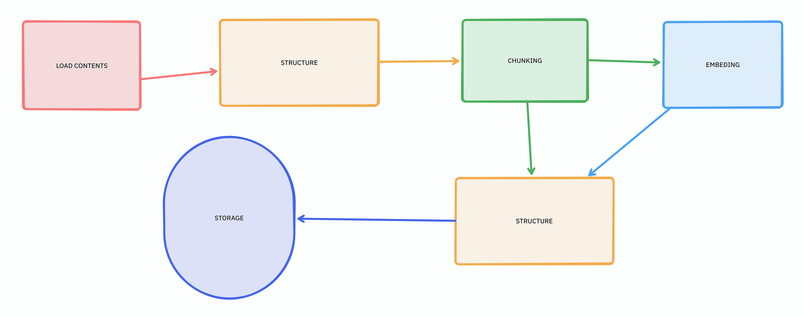

# RAG From Scratch

**By Faseeh Ur Rehman — aka [Faseeu](https://github.com/Faseeu)**

A Retrieval-Augmented Generation agent built from the ground up — **no RAG frameworks**. No LangChain, no LlamaIndex. The hybrid retrieval, RRF fusion, reranking, query rewriting, guard layers, conversation memory, and citation verification are all written by hand, and every line is understood.


## The query pipeline (V5)

Run `uv run rag-chat`, pick a collection, and every query walks this path:

1. **Guard preprocessor (4 layers, cheap → expensive)** — `src/rag/query/guard/preprocessor.py`
   Exact-match greetings → fuzzy match → cached-FAQ vector search → small-LLM classifier.
   Simple queries ("hey", "who are you?") get answered here without ever hitting the full pipeline.
2. **Contextualization** — `src/rag/query/contextualize.py`
   Rewrites the query into a standalone question using conversation memory, so follow-ups like *"and why does that happen?"* work.
3. **Decomposition** — `src/rag/providers/llm/decomposer.py`
   Splits the query into independent sub-queries.
4. **Dual query rewriting** — `src/rag/providers/llm/query_rewriter.py`
   5 semantic rewrites for the vector search + 5 keyword-dense rewrites for BM25 — the two retrievers want *opposite* phrasings.
5. **Hybrid retrieval** — `src/rag/retrieval/dense.py` + `src/rag/retrieval/sparse.py`
   Dense retrieval from Qdrant (Snowflake `arctic-embed-s`, 384-dim) plus BM25 lexical search over the corpus.
6. **RRF fusion** — `src/rag/retrieval/fusion.py`
   Reciprocal-rank fusion merges both result lists into one ranked set.
7. **Cross-encoder rerank** — `src/rag/retrieval/rerank.py`
   `ms-marco-MiniLM-L-6-v2` re-scores the fused chunks and keeps the best.
8. **Prompt building** — `src/rag/generation/prompt.py`
   Context chunks + recent conversation memory → final prompt.
9. **Answer generation** — `src/rag/providers/llm/groqclient.py` + `src/rag/verify/answerschema.py`
   Groq (`openai/gpt-oss-120b`) streams a **structured** answer (answer + citations), validated with Pydantic.
10. **Citation verification** — `src/rag/verify/quote_score.py`
    Every cited quote is fuzzy-matched (rapidfuzz) against the chunk it claims to come from, and a score is printed — so hallucinated citations get flagged, not silently accepted.

## Ingestion



`src/rag/ingest/indexer.py` → PDF → markdown (`pymupdf4llm`) → token-aware chunking → batch embedding → a Qdrant collection with deterministic UUID5 ids and sanitized collection names.

## Project layout

```
apps/cli/chat.py          # interactive chat entry point
src/rag/config.py         # pydantic-settings: API keys, models, tunables
src/rag/engine.py         # existing engine module
src/rag/ingest/           # loaders, chunkers, indexing, collection registry
src/rag/query/            # contextualization and guard preprocessing
src/rag/retrieval/        # dense, BM25, RRF fusion, reranking
src/rag/generation/       # prompt assembly
src/rag/verify/           # answer schema and citation checks
src/rag/memory/           # session-based conversation memory
src/rag/providers/        # embeddings, Groq, and vector-store adapters
src/rag/interface/        # existing typed ports and contracts
src/rag/utils/            # helpers: sanitize_name, cleanRAG
experimental/             # experiments (jev evaluation clients)
data/seed/                # committed sample corpus
data/                     # runtime caches and registry
docs/                     # assets, interface notes, learning journal
tests/                    # compatibility and contract tests
```

## Getting started

**Prerequisites:** Python 3.12+, [`uv`](https://docs.astral.sh/uv/), Docker Compose, and a Groq API key.

```bash
uv sync
cp .env.example .env
# Add your GROQ_API_KEY to .env

docker compose up -d qdrant
uv run rag-chat
```

To run the chat in Docker instead of locally:

```bash
cp .env.example .env
# Add your GROQ_API_KEY to .env
docker compose build
docker compose up -d qdrant
docker compose run --rm chat
```

Qdrant, application data, and downloaded models use persistent Docker volumes. To ingest a document in Docker, place it in the gitignored `documents/` staging folder and run `docker compose run --rm data-import`; this copies files into the app data volume. The current CLI still expects its configured PDF filename (`Daniel Kahneman-Thinking, Fast and Slow .pdf`) when creating a collection, so that name must be present for first-time ingestion. Then run the chat service and type `q` to quit. The sample text corpus is at `data/seed/basic_ai.txt`.

### Environment variables

| Variable        | Used by                                   | Required               |
| --------------- | ----------------------------------------- | ---------------------- |
| `GROQ_API_KEY`  | all LLM calls (answers, rewriting, guard) | yes                    |
| `HF_TOKEN`     | cross-encoder reranker                    | recommended            |
| `JINA_API_KEY` | `embedding_mode="jina"`, FAQ cache build  | only for Jina mode     |

## Configuration

Every tunable lives in `src/rag/config.py` and can be overridden from `.env` (pydantic-settings). Highlights:

| Setting                | Default                                 | Controls                       |
| ---------------------- | --------------------------------------- | ------------------------------ |
| `default_llm_model`    | `openai/gpt-oss-120b`                   | main answer model (Groq)       |
| `router_llm_model`     | `openai/gpt-oss-20b`                    | small routing/rewrite model    |
| `guard_llm_model`      | `openai/gpt-oss-20b`                    | guard-layer classifier         |
| `embedding_model`      | `Snowflake/snowflake-arctic-embed-s`    | local embedder (384-dim)       |
| `embedding_mode`       | `local`                                 | `local` or `jina`              |
| `chunk_size`           | `450`                                   | chunk token budget             |
| `chunk_overlap`        | `70`                                    | chunk overlap                  |
| `retrieval_top_k`      | `15`                                    | candidates per retriever       |
| `retrieval_threshold`  | `0.5`                                   | Qdrant similarity floor        |
| `rrf_merge_top_k`      | `10`                                    | fused results kept             |
| `rerank_top_k`         | `5`                                     | chunks kept after rerank       |
| `rerank_model`         | `cross-encoder/ms-marco-MiniLM-L-6-v2`  | reranker                       |
| `batch_size`           | `128`                                   | embedding batch size           |

`settings.save()` snapshots the tunables to `data/settings.json` (gitignored), which is re-loaded on startup.

## Notes

- Earlier iterations (V1–V4) used a flat JSON vector store — that code lives on in `src/rag/providers/vectorstore/storage.py` and `src/rag/ingest/ingest.py`, and `src/rag/utils/cleanRAG.py` is a small maintenance script for it.
- Everything generated at runtime — `sessions/`, `qdrant_storage/`, `data/RAG.json`, `conversation_memory.json` — is gitignored on purpose; the repo only carries source and seed data.
- Developer tasks: `just test`, `just lint`, `just fix`, and `just build` (requires `just` and `uv`).
- CI runs the offline test suite, Ruff lint, and a wheel build on Python 3.12.
